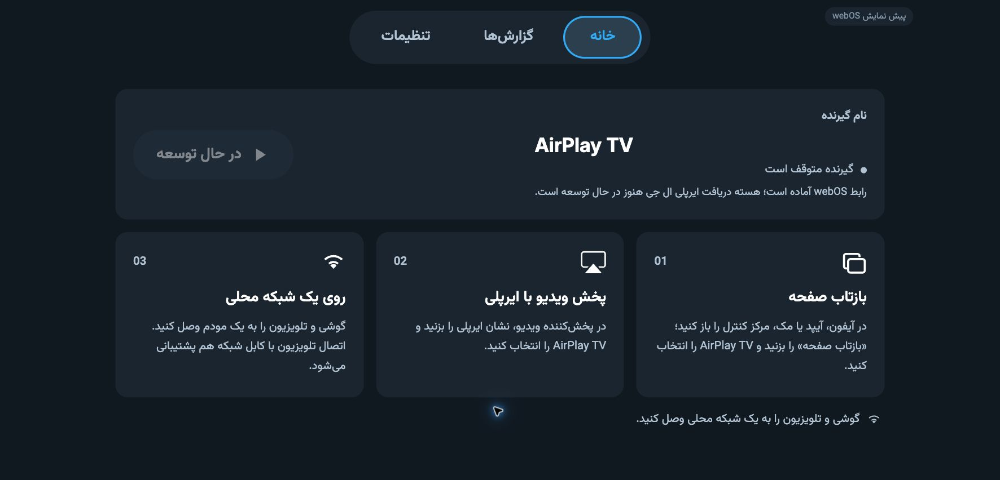
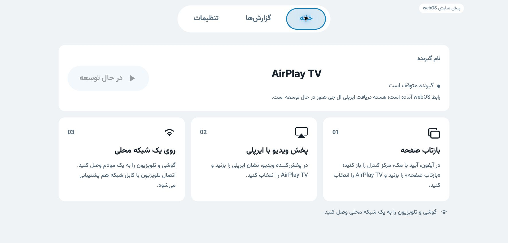

<p align="center"></p>

# ایر پلی تی وی - AirPlay TV | LG webOS

برنچ مخصوص تلویزیون های **ال جی با webOS**، با رابط تلی تیره و روشن، فارسی پیش فرض و کنترل با ریموت.

> نسخه فعلی، پیش نمایش رابط با بسته توسعه IPK است. هسته دریافت AirPlay برای webOS هنوز پیاده سازی نشده و برنامه روی تلویزیون ال جی تست نشده است. دکمه دریافت تا آماده شدن هسته غیرفعال است.

## پیش نمایش رابط

| تلی دارک | تلی لایت |
| --- | --- |
|  |  |

تصاویر از اجرای همین نسخه webOS در مرورگر گرفته شده اند؛ عکس اجرای برنامه روی تلویزیون نیستند.

## امکانات آماده

- انتخاب فارسی، انگلیسی یا ترکیبی در اولین اجرا و تنظیمات
- تم تلی تیره و روشن و حالت ساده، فونت وزیرمتن و رابط راست به چپ
- جابه جایی با دکمه های جهت، انتخاب با Enter و بازگشت با Back
- پشتیبانی از کد Back ریموت webOS و انتخاب با کلیک نشانگر
- ذخیره زبان و تم روی همان دستگاه، صفحه گزارش ها و معرفی سازنده در انتهای تنظیمات
- متادیتای مخصوص webOS، آیکون های نصب و ساخت بسته IPK با ابزار رسمی ال جی

## وضعیت این نسخه

| بخش | وضعیت |
| --- | --- |
| رابط، تم ها و کنترل با کلیدها | ساخته شده؛ بررسی در مرورگر |
| آداپتور رابط webOS و دکمه Back | پیاده سازی و تست شده |
| بسته IPK مخصوص رابط | ساخته و محتوای آن بررسی شده |
| هدف اولیه رابط | webOS 6 و جدیدتر، با خروجی JavaScript برای Chromium 79 |
| نصب روی تلویزیون ال جی | هنوز انجام نشده |
| هسته AirPlay، کشف شبکه، اتصال و پخش | هنوز پیاده سازی نشده |

## اجرای پیش نمایش

نیازمندی ها: Node.js 20 یا بالاتر، npm، Python 3 و Git.

```sh
git clone --branch codex/webos-receiver https://github.com/MehdiEskandari/airplay-tv.git
cd airplay-tv
npm --prefix tv-web ci
npm --prefix tv-web test
npm --prefix tv-web run dev
```

آدرس `http://127.0.0.1:4180` را باز کنید. برای این پیش نمایش به تلویزیون یا حساب ال جی نیاز نیست.

## ساخت بسته و تست روی ال جی

```sh
npm --prefix tv-web run package:webos
python3 platforms/webos/tests/package.py
```

خروجی:

```text
platforms/webos/output/io.github.mehdieskandari.airplaytv.webos_0.1.0_all.ipk
```

این بسته برای بررسی رابط روی دستگاه توسعه است. فایل IPK پس از اجرای موفق [GitHub Actions این برنچ](https://github.com/MehdiEskandari/airplay-tv/actions?query=branch%3Acodex%2Fwebos-receiver) در بخش Artifacts هم قرار می گیرد.

برای نصب آزمایشی، تلویزیون ال جی باید با برنامه Developer Mode برای اتصال توسعه آماده شود. [راهنمای نصب، ساختار و وضعیت هسته](platforms/webos/README.md).

## ساختار این برنچ

| مسیر | محتوا |
| --- | --- |
| [tv-web/src](tv-web/src) | رابط، تم ها، زبان ها و کنترل ریموت |
| [آداپتور webOS](tv-web/src/platforms/webos.js) | تشخیص دستگاه و مرز اتصال هسته آینده |
| [platforms/webos/appinfo.json](platforms/webos/appinfo.json) | شناسه و مشخصات برنامه ال جی |
| [platforms/webos/scripts](platforms/webos/scripts) | ساخت بسته IPK |
| [platforms/webos/tests](platforms/webos/tests) | بررسی محتوای بسته ساخته شده |
| [تصاویر webOS](docs/screenshots/webos) | پیش نمایش های همین نسخه |

## مجوز و سازنده

[GPL-3.0](LICENSE). فونت وزیرمتن با مجوز [SIL Open Font License](fonts-licenses/Vazirmatn-OFL.txt) استفاده شده است.

سازنده: [مهدی اسکندری](https://github.com/MehdiEskandari). این پروژه وابسته به Apple یا LG نیست. AirPlay نشان تجاری Apple است.
