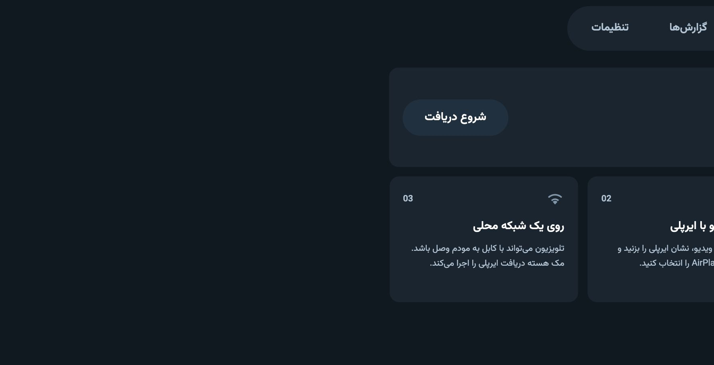

<p align="center"></p>

# ایر پلی تی وی - AirPlay TV | Samsung Legacy

نسخه آزمایشی برای تلویزیون های قدیمی سامسونگ با **Legacy / Orsay**. دستگاه هدف فعلی **Samsung UA46ES5600، سری E سال ۲۰۱۲** است؛ رابط تلی برای مرورگر قدیمی این نسل آماده شده است.

> این نسخه به یک مک روشن در همان شبکه نیاز دارد. هسته AirPlay روی مک اجرا می شود و تلویزیون، رابط و پخش کننده ویدیو را اجرا می کند. نصب ویجت و تست کامل ایرپلی روی دستگاه هدف هنوز انجام نشده است.

## پیش نمایش رابط

| تلی دارک | تلی لایت |
| --- | --- |
|  |  |

تصاویر از اجرای همین نسخه در مرورگر گرفته شده اند؛ عکس اجرای برنامه روی تلویزیون نیستند.

## امکانات این نسخه

- فارسی پیش فرض و انتخاب فارسی، انگلیسی یا ترکیبی در اولین اجرا
- تم تلی تیره و روشن و حالت ساده، فونت وزیرمتن و رابط راست به چپ
- کنترل با دکمه های جهت، Enter و Return ریموت
- تنظیم نام گیرنده، گزارش رویدادها و معرفی سازنده در انتهای تنظیمات
- کد رابط سازگار با ES5 و چیدمان مناسب مرورگر قدیمی تلویزیون
- هسته UxPlay روی مک، تبدیل تصویر به H.264 و صدا به AAC و ارسال HLS به پخش کننده تلویزیون
- تایید هر درخواست اتصال و گزینه پخش الگوی آزمایشی از تنظیمات

## وضعیت ساخت و تست

| بخش | وضعیت |
| --- | --- |
| رابط و تم ها | ساخته شده؛ بررسی در مرورگر و اعتبارسنجی ES5 |
| هسته مک | کامپایل شده؛ معرفی سرویس و پاسخ RTSP بررسی شده |
| پردازش H.264 و AAC | تست محلی تصویر و صدای غیرصفر گذرانده شده |
| پخش فایل آزمایشی روی تلویزیون | دستگاه وضعیت PLAYING و پیشروی زمان ۰ تا ۵ ثانیه را گزارش کرده است |
| بسته ZIP و فهرست نصب | ساخته شده؛ دریافت آزمایشی از سرور بررسی شده |
| نصب ویجت و پخش HLS در آن | هنوز روی تلویزیون تایید نشده |
| اتصال واقعی ایرپلی و مشاهده تصویر و شنیدن صدا | هنوز تایید نشده |

تست فایل ویدیو از مسیر DLNA انجام شده است؛ نتیجه آن به معنی نصب ویجت یا تایید پخش ایرپلی نیست.

## راه اندازی روی مک

نیازمندی ها: macOS، ابزارهای توسعه Apple، Homebrew OpenSSL 3، Python 3 و Git.

```sh
git clone --branch codex/samsung-legacy --recurse-submodules https://github.com/MehdiEskandari/airplay-tv.git
cd airplay-tv
python3 -m venv platforms/samsung-legacy/.cache/python
platforms/samsung-legacy/.cache/python/bin/pip install -r platforms/samsung-legacy/requirements-host.txt
python3 platforms/samsung-legacy/scripts/build-host.py
platforms/samsung-legacy/.cache/python/bin/python platforms/samsung-legacy/scripts/companion.py --tv YOUR_TV_IP
```

به جای `YOUR_TV_IP` آدرس شبکه تلویزیون را بنویسید. مک و تلویزیون باید به یک شبکه محلی وصل باشند؛ اتصال کابلی تلویزیون هم قابل استفاده است. این فرمان، سرور هسته و بسته مخصوص همان شبکه را آماده می کند.

## نصب روی تلویزیون سری E

1. در Smart Hub با حساب مخصوص `develop` وارد شوید و منوی **Tools → Settings → Development** را باز کنید. اگر حساب ساخته نشده، از **Login → Create Account** با شناسه `develop` و یک رمز دلخواه آن را بسازید.
2. در یک پنجره دیگر Terminal، سرور نصب را اجرا کنید:

   ```sh
   sudo python3 platforms/samsung-legacy/scripts/installer.py --host YOUR_MAC_LAN_IP --tv YOUR_TV_IP
   ```

   `YOUR_MAC_LAN_IP` آدرس مک در همان شبکه است. دسترسی مدیر برای باز کردن پورت ۸۰ لازم است؛ سرور پس از باز کردن پورت، دسترسی مدیر را کنار می گذارد و پس از ۳۰ دقیقه متوقف می شود.
3. در تلویزیون، **Setting Server IP** را روی آدرس مک بگذارید. پیش از **User Application Synchronization**، برنامه های نصب شده با develop را بررسی کنید؛ همگام سازی ممکن است مجموعه قبلی این برنامه ها را جایگزین کند.
4. برنامه **AirPlay TV Legacy** را باز کنید، زبان را انتخاب کنید و ابتدا گزینه تست پخش را اجرا کنید. پس از تایید تصویر و صدا، اتصال ایرپلی از آیفون، آیپد یا مک را آزمایش کنید.

خروجی محلی: `platforms/samsung-legacy/output/AirPlayTVLegacy_0.1.0.zip`. این بسته شامل کلید ارتباط محلی است و نباید به عنوان فایل دانلود عمومی منتشر شود.

[راهنمای کامل ساخت، معماری، محدودیت ها و تست](platforms/samsung-legacy/README.md).

## ساختار این برنچ

| مسیر | محتوا |
| --- | --- |
| [platforms/samsung-legacy/web](platforms/samsung-legacy/web) | رابط ES5 و سبک های مخصوص Orsay |
| [platforms/samsung-legacy/bridge](platforms/samsung-legacy/bridge) | هسته دریافت و پردازش رسانه روی مک |
| [platforms/samsung-legacy/scripts](platforms/samsung-legacy/scripts) | ساخت، سرور هسته و سرور نصب |
| [platforms/samsung-legacy/tests](platforms/samsung-legacy/tests) | تست های پردازش رسانه و HTTP |
| [تصاویر Legacy](docs/screenshots/samsung-legacy) | پیش نمایش های همین نسخه |

## مجوز و سازنده

[GPL-3.0](LICENSE). فونت وزیرمتن با مجوز [SIL Open Font License](fonts-licenses/Vazirmatn-OFL.txt) استفاده شده است.

سازنده: [مهدی اسکندری](https://github.com/MehdiEskandari). این پروژه وابسته به Apple یا Samsung نیست. AirPlay نشان تجاری Apple است.
