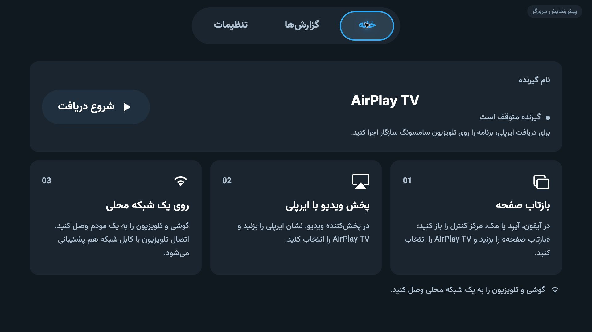
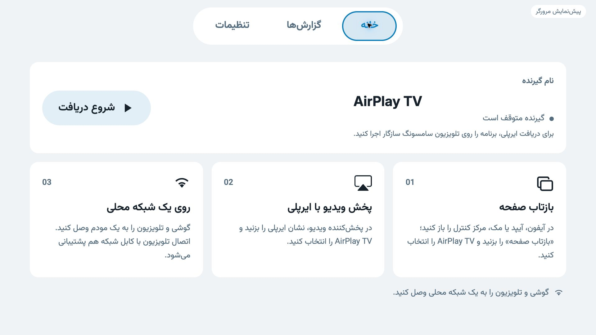

<p align="center"></p>

# ایر پلی تی وی - AirPlay TV | Samsung Tizen

نسخه آزمایشی گیرنده AirPlay برای تلویزیون سامسونگ با **Tizen 5.5 و بالاتر**، با رابط تلی، فارسی پیش فرض و کنترل با ریموت.

> این برنچ مخصوص Tizen است. رابط و هسته ساخته شده اند؛ اتصال و پخش واقعی روی تلویزیون سازگار هنوز تایید نشده است. بسته بدون امضا برای نصب آماده نیست.

## پیش نمایش رابط

| تلی دارک | تلی لایت |
| --- | --- |
|  |  |

تصاویر از اجرای همین نسخه در مرورگر گرفته شده اند؛ عکس اجرای برنامه روی تلویزیون نیستند.

## امکانات این نسخه

- سه حالت زبان: فارسی، انگلیسی و ترکیبی؛ انتخاب در اولین اجرا و تنظیمات
- تم تلی تیره و روشن و حالت ساده، فونت وزیرمتن و پشتیبانی از راست به چپ
- جابه جایی با دکمه های جهت، انتخاب با Enter و بازگشت با Back
- نام گیرنده، گزارش رویدادها و معرفی سازنده در انتهای تنظیمات
- هسته AirPlay مبتنی بر UxPlay، با دریافت TCP/UDP و معرفی گیرنده از طریق mDNS
- مسیر پخش H.264 با Samsung EMSS و ویدیوی HLS با AVPlay
- درخواست اجازه برای دستگاه جدید، مهلت ۳۰ ثانیه ای و نگهداری هویت های تایید شده روی تلویزیون

امکانات مربوط به اتصال و پخش، در کد پیاده سازی شده اند و به تست روی سخت افزار نیاز دارند.

## وضعیت ساخت و تست

| بخش | وضعیت |
| --- | --- |
| رابط، زبان ها و تم ها | ساخته شده؛ بررسی در مرورگر |
| هسته Samsung WebAssembly | کامپایل شده |
| تست های JavaScript و رکوردهای mDNS | گذرانده شده |
| بسته WGT | آرشیو بدون امضای توسعه ساخته شده |
| امضا و نصب روی تلویزیون | در انتظار گواهی Samsung TV و دستگاه سازگار |
| شناسایی با آیفون، اتصال، تصویر و صدای واقعی | هنوز روی تلویزیون تایید نشده |

## اجرای رابط در مرورگر

نیازمندی ها: Git، Node.js، npm و Python 3.

```sh
git clone --branch codex/tizen-receiver --recurse-submodules https://github.com/MehdiEskandari/airplay-tv.git
cd airplay-tv
npm --prefix tv-web ci
npm --prefix tv-web test
npm --prefix tv-web run dev
```

آدرس `http://127.0.0.1:4179` را باز کنید. این اجرا برای بررسی رابط است؛ دریافت AirPlay به هسته و APIهای تلویزیون نیاز دارد.

## ساخت هسته و نصب روی تلویزیون

تلویزیون باید افزونه های سوکت و پخش Samsung WebAssembly را داشته باشد. هدف اولیه، مدل های تایزن ۵.۵ / سال ۲۰۲۰ و جدیدتر است؛ سازگاری هر مدل باید بررسی شود.

1. هسته را با SDK مخصوص Samsung Emscripten بسازید.
2. در Tizen Studio یک پروفایل گواهی Samsung TV با DUID تلویزیون آزمایشی بسازید.
3. بسته را با همان پروفایل امضا کنید و از طریق اتصال توسعه دهنده روی تلویزیون نصب کنید.

پس از ساخت هسته، فرمان بسته بندی از ریشه مخزن:

```sh
npm --prefix tv-web run package -- --profile YOUR_SAMSUNG_TV_PROFILE
```

خروجی در `platforms/tizen/output/` ساخته می شود. [راهنمای کامل SDK، ساخت، امضا و تست](platforms/tizen/README.md).

## ساختار این برنچ

| مسیر | محتوا |
| --- | --- |
| [tv-web/src](tv-web/src) | رابط، تم ها، زبان ها و کنترل ریموت |
| [آداپتور تایزن](tv-web/src/platforms/tizen.js) | اتصال رابط به APIهای سامسونگ |
| [platforms/tizen/native](platforms/tizen/native) | هسته دریافت، کشف شبکه و پخش |
| [platforms/tizen/scripts](platforms/tizen/scripts) | ساخت هسته و بسته بندی WGT |
| [تصاویر تایزن](docs/screenshots/tizen) | پیش نمایش های همین نسخه |

## مجوز و سازنده

[GPL-3.0](LICENSE). فونت وزیرمتن با مجوز [SIL Open Font License](fonts-licenses/Vazirmatn-OFL.txt) استفاده شده است.

سازنده: [مهدی اسکندری](https://github.com/MehdiEskandari). این پروژه وابسته به Apple یا Samsung نیست. AirPlay نشان تجاری Apple است.
