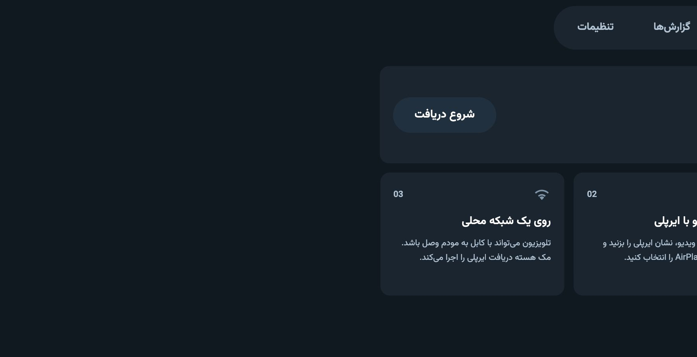
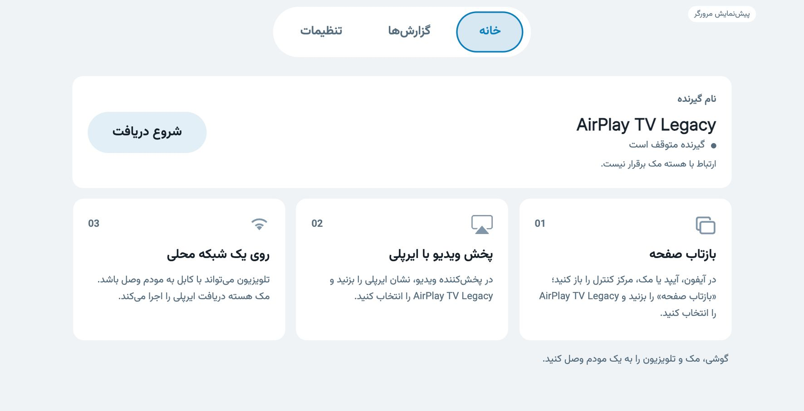

# Samsung Legacy / Orsay prototype

نسخه آزمایشی برای **Samsung UA46ES5600 (E-series, 2012)** با همان تم تلی تیره و روشن، فارسی پیش‌فرض، سه زبان و معرفی سازنده در انتهای تنظیمات.

[معرفی فارسی و شروع کار](../../README.md)

**This is a companion-based prototype.** The TV runs an ES5 widget and its native Player plug-in; a Mac on the same LAN receives AirPlay and produces H.264/AAC HLS for the TV. The Mac must remain on. A standalone AirPlay receiver on this 2012 TV has not been established: its public Legacy SDK does not expose the UDP/native facilities needed by the protocol core, and Samsung's NaCl support begins in 2013.

| Legacy Teli dark — browser preview | Legacy Teli light — browser preview |
| --- | --- |
|  |  |

## Verified so far

- The real TV identifies as UA46ES5600 and exposes its DLNA renderer.
- A generated 720p H.264/AAC MP4 was delivered to the TV. It requested the file with HTTP HEAD and byte-range GET, reported `PLAYING`, and advanced its playback position from 0 to 5 seconds before the bounded test stopped. This is transport/decoder evidence; visible image and audible sound still need the owner's confirmation.
- The Mac AirPlay core compiled, registered its AirPlay/RAOP services through Bonjour, and answered an actual RTSP `/info` request with a valid binary plist and a 1280×720 display.
- Sanitized host tests decoded portrait H.264 into letterboxed 720p frames and scheduled non-silent AAC audio. HTTP authorization/validation tests passed. The Legacy JS entry point parses as ECMAScript 5; remote navigation and both themes were checked in a browser.
- The ZIP/catalog installer was tested on an unprivileged test port: package length, entries, fonts and active companion configuration match.
- **Widget installation and end-to-end AirPlay-to-TV playback are still pending.** No widget-ready or native TV Player telemetry has been received. There is no claim of standalone AirPlay, confirmed synchronization, or release readiness.

## Build the Mac companion

Prerequisites: macOS developer tools, Homebrew OpenSSL 3, Python 3 and the repository's source submodules.

```sh
python3 -m venv platforms/samsung-legacy/.cache/python
platforms/samsung-legacy/.cache/python/bin/pip install -r platforms/samsung-legacy/requirements-host.txt
python3 platforms/samsung-legacy/scripts/build-host.py
platforms/samsung-legacy/.cache/python/bin/python \
  platforms/samsung-legacy/scripts/companion.py --tv YOUR_TV_IP
```

The host build uses an isolated UxPlay archive with the existing Android fixes and the verified-sender adapter patch. It does not reset the shared dirty submodule. FFmpeg's H.264/AAC/ALAC decoders and scaler are built from the pinned submodule; the separately pinned imageio-ffmpeg package supplies the HLS encoder executable.

The companion selects a LAN address on the TV's subnet, binds HTTP port 4188, and limits clients to that TV and the Mac. A local per-widget credential protects receiver control. Secrets, pairing identity, runtime media, diagnostics and generated packages stay in ignored directories. The browser preview deliberately omits the widget credential and never claims to be receiving AirPlay.

## Install on the E-series TV

1. On the TV, open Smart Hub and use Login (the red A key). If needed, choose Create Account, set the ID to **`develop`**, choose a password and then log in. Open Tools → Settings → Development. Complete the account and terms steps on the TV.
2. Start the local install server using the same Mac LAN IP selected by the companion:

   ```sh
   sudo python3 platforms/samsung-legacy/scripts/installer.py \
     --host YOUR_MAC_LAN_IP --tv YOUR_TV_IP
   ```

   Samsung's development sync uses port **80**, which requires administrator permission on macOS. Enter the password in Terminal. The server drops root immediately after binding, serves only this widget/catalog to the specified TV/Mac, and stops after 30 minutes.
3. In the TV's Development menu, set **Server IP** to the Mac LAN IP. Before choosing **User Application Synchronization**, check whether other developer-installed widgets must be preserved: Samsung's sync can replace the previous development app set. Store-installed apps are a separate category.
4. Synchronize, then launch **AirPlay TV Legacy**. The local diagnostic log should receive `widget-ready` with the real TV's user agent and Player availability.
5. Choose the language, then use **Test playback on the TV** in settings. Confirm the TV actually shows the pattern and plays the quiet test tone. Only then select **AirPlay TV Legacy** from an iPhone/iPad/Mac and approve the connection on the TV.

`output/AirPlayTVLegacy_0.1.0.zip` and `output/widgetlist.xml` are generated when the companion starts. The ZIP contains its local receiver credential and should not be published. A manual build defaults to the existing companion credential; a non-local package without a configured companion is refused.

## Design and platform boundary

The widget bundles three language dictionaries, the AirPlay logo, static Vazirmatn weights, the creator portrait and the Teli palette. Its entry point is handwritten ES5. The build resolves CSS variables to actual theme rules; explicit table/float layouts replace CSS grid, modern flex layout and logical-property dependencies. The native Player is called through Samsung SEF, following Samsung's Orsay TOAST implementation. Actual WebKit 534 font/SVG/rendering behavior still requires widget installation on the device.

The Mac decodes mirrored H.264, scales it to 720p, schedules video/audio against nanosecond NTP timestamps, then encodes a conservative H.264/AAC stream. This introduces latency; lip sync, reconnects, long sessions, remote-video scrubbing and model-specific HLS behavior remain experimental. Native elementary playback on the TV is not claimed.

New-device approval expires after 30 seconds and fails closed. This initial Legacy UI offers permission for the current request only. Receiver readiness waits for native sockets and Bonjour registration. Media playback starts from actual relay output, not a simulated timer. Once a real widget has connected, a lost heartbeat stops receiving. No analytics has been added.

## Tests and diagnostics

```sh
npm --prefix tv-web test
python3 platforms/samsung-legacy/tests/http_test.py
platforms/samsung-legacy/.cache/python/bin/python platforms/samsung-legacy/tests/media.py
```

The native media check uses ASan/UBSan, real encoded fixtures, verified pillarboxing, a common clock and non-zero decoded PCM. It does not prove TV audio output.

`scripts/dlna-test.py` is the bounded decoder test for the already-discovered device endpoints. It refuses to interrupt an existing media session. It tests a local MP4 independently of widget installation and does not test AirPlay. Runtime evidence is in `.cache/`; do not commit private LAN details or widget credentials.

## Primary references

- [Samsung Legacy FAQ: develop account, installation and UDP constraints](https://developer.samsung.com/smarttv/legacy/samsung-legacy-platform-faq.html)
- [Samsung Legacy platform and WebKit generation](https://developer.samsung.com/smarttv/legacy/overview.html)
- [Samsung Native Client starts in 2013](https://developer.samsung.com/smarttv/develop/extension-libraries/nacl/overview.html)
- [Samsung Orsay widget configuration template](https://github.com/Samsung/cordova-sectv-orsay/blob/master/www/config.xml.tmpl)
- [Samsung Orsay Player adapter](https://github.com/Samsung/cordova-plugin-toast/blob/master/src/sectv-orsay/mediaProxy.js)
