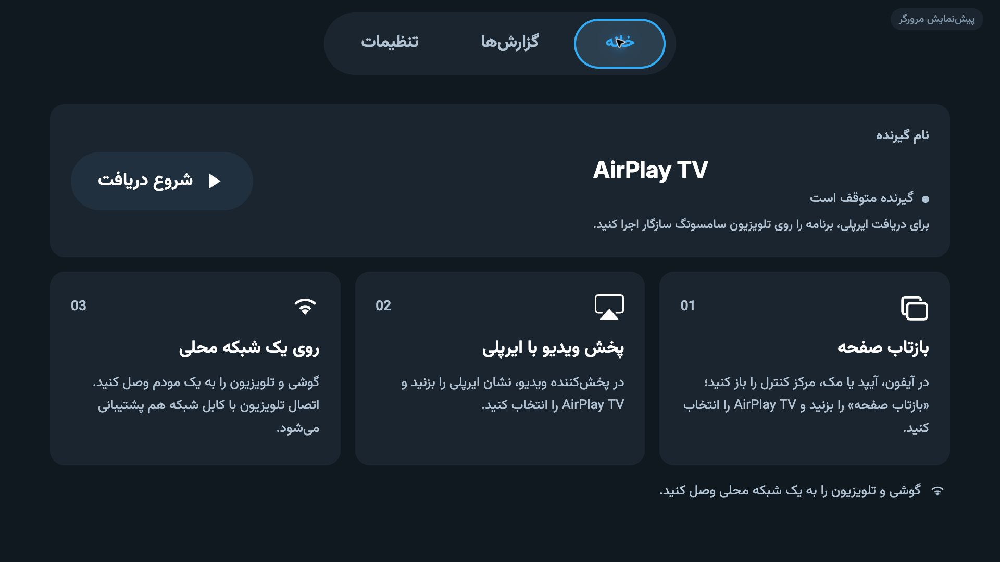
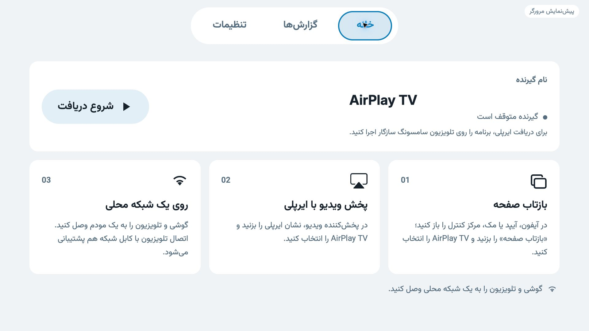

# AirPlay TV for Samsung Tizen — development prototype

نسخه آزمایشی مخصوص Samsung Tizen، با رابط تلی تیره و روشن، فونت وزیرمتن، فارسی پیش فرض و انتخاب سه زبان. هسته تایزن جدا از رابط ساخته می شود. این نسخه هنوز روی تلویزیون سازگار تست نشده و نسخه آماده انتشار نیست.

[معرفی فارسی و شروع کار](../../README.md)

| Teli dark — browser preview | Teli light — browser preview |
| --- | --- |
|  |  |

## Target and current boundary

- Target: Samsung TV with **Tizen 5.5 / 2020 or later**, subject to hardware verification. The Samsung WebAssembly socket and media extensions are required. A normal browser is a UI preview, never an AirPlay receiver.
- The native adapter reuses the repository's patched UxPlay protocol core, OpenSSL 3.4.4 and minimal FFmpeg AAC/ALAC decoders. It implements TCP/UDP receiving, multicast AirPlay/RAOP service advertisements, H.264 elementary playback through Samsung EMSS and HLS URLs through AVPlay.
- Physical discovery from an iPhone/Mac, pairing, audible audio, video, synchronization, repeat connections, background/resume and model-specific decoder support remain **unverified**. A successful compile is not evidence of playback.
- Playback is full-screen. Boot auto-start, DLNA, HEVC, subtitle controls and PIN settings are not implemented in this prototype. New-device approval defaults on and expires after 30 seconds. Remembered identities require a verified sender signature, rather than trusting a spoofable device name.
- Settings, random receiver identity, pairing identity and allowed public keys stay on the TV. No analytics has been added.

## Build and preview the interface

From the repository root:

```sh
cd tv-web
npm ci
npm test
npm run dev
```

Open `http://127.0.0.1:4179`. This server binds to localhost only. It rebuilds on startup; run `npm run build` after edits. Arrow keys move focus, Enter activates, and Escape/TV Back returns or opens the exit dialog. Fonts, portrait, icon and all three language dictionaries are exported from existing Android assets. The canonical AirPlay vector is reused directly.

The interface targets Chromium 69 (Tizen 5.5). Focus uses rounded inset borders. Flex spacing does not depend on newer flex-gap support.

## Build the receiver

Install the **Samsung Emscripten 1.39.4.7 macOS bundle**, not upstream Emscripten. Python 3.12+ needs setuptools for the SDK's `distutils` imports. The Intel macOS compiler also requires Rosetta on Apple Silicon.

```sh
python3 -m venv /path/to/tizen-python
/path/to/tizen-python/bin/pip install setuptools
python3 platforms/tizen/scripts/build-core.py \
  --sdk /path/to/emsdk \
  --python /path/to/tizen-python/bin/python \
  --jobs 4
```

The script corrects the official SDK's Samsung C++ library flags from C++14 to C++17 to match its constexpr-lambda source and enables their multithreaded variants so they can link with shared-memory AirPlay workers. It isolates Emscripten caches and builds under `platforms/tizen/`; OpenSSL's release SHA256 is verified. It exports the pinned UxPlay revision and applies Android fixes plus a Tizen-only verified-sender callback patch to that copy. The original submodule is not reset or patched by this build.

FFmpeg configure probes must produce real `.js` link targets: the old SDK treats executables without extensions as relocatable objects and would otherwise falsely detect unavailable libc functions. The wrapper applies this only to configure/link probes.

Outputs: `build/core/airplay-core.js`, `.wasm`, `.worker.js`, license files and build provenance. The browser thread owns the UI and persistent IDBFS; the native main loop, protocol, mDNS and media work run on workers. Native start merely queues work; the UI shows readiness only after HTTP sockets and multicast advertisement are running. Errors and timeouts stop receiving.

## Package and install

```sh
cd tv-web
npm run package -- --unsigned
# After a Samsung TV certificate profile has been created in Tizen Studio:
npm run package -- --profile YOUR_SAMSUNG_TV_PROFILE
```

The unsigned WGT is a development archive, **not installable or store-ready**. Packaging refuses a UI-only build or missing WASM/worker output. For signing, `tizen` must be on PATH (or set `TIZEN_CLI`). Use Samsung's current TV certificate extension and the test TV's DUID when creating a developer certificate profile. Do not commit certificates, passwords or private keys.

On a compatible TV, Developer Mode and an authorized developer connection must be configured before `tizen install`. No such connection can make a Legacy TV run a Tizen widget.

## Tizen project structure

`tv-web/src/app.js`, `style.css`, `i18n.js` and `remote.js` own the interface. `src/engine.js` owns receiver state independently of the platform. `src/platforms/tizen.js` supplies SDK loading, local IP, exit and media APIs. The native event/command boundary is explicit and includes a run ID to discard old asynchronous callbacks after stop/restart.

## Verification

```sh
cd tv-web && npm test && npm run build
cd ..
python3 platforms/tizen/tests/discovery.py
```

The host discovery check validates actual DNS wire records, UTF-8 instance labels, addresses, ports and 10,000 malformed questions with address/undefined-behavior sanitizers. JS tests cover persistence, invalid settings, real-ready gating, failed startup, stale callbacks, stop during load, remote directions and the AVPlay lifecycle. These checks do not simulate or establish real TV playback.

## Primary references

- [Samsung WebAssembly support](https://developer.samsung.com/smarttv/develop/extension-libraries/webassembly/overview.html)
- [Samsung Emscripten download](https://developer.samsung.com/smarttv/develop/extension-libraries/webassembly/download.html)
- [TCP/UDP sockets extension](https://developer.samsung.com/smarttv/develop/extension-libraries/webassembly/api-reference/tizen-sockets-extension.html)
- [Samsung WASM Player](https://developer.samsung.com/smarttv/develop/extension-libraries/webassembly/tizen-wasm-player/overview.html)
- [Legacy platform compatibility](https://developer.samsung.com/smarttv/legacy/samsung-legacy-platform-faq.html)
