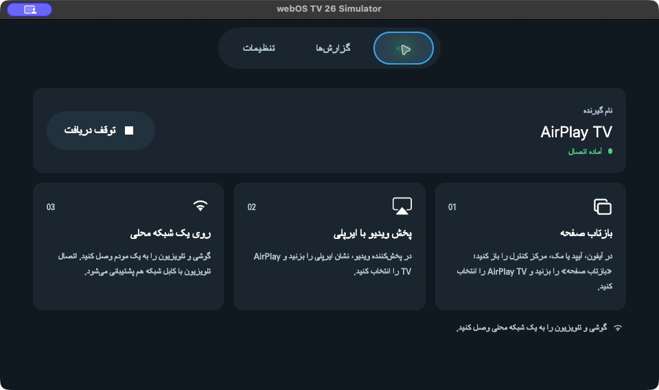
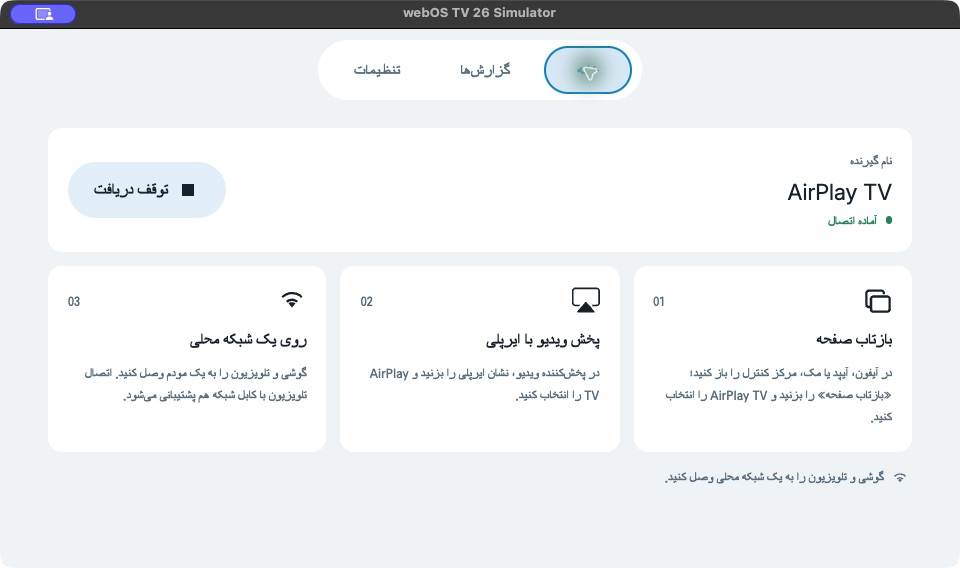

# AirPlay TV for LG webOS — experimental receiver

[معرفی فارسی و ساخت](../../README.md)

Version **0.2.0** adds a portable UxPlay receiver core, a webOS Node JavaScript service, H264 browser playback and decoded PCM audio. The Teli interface retains Persian by default, English/mixed language modes, dark/light/solid themes and remote navigation. The core targets **webOS 22+ (Node 12+)**. The earlier UI-only target of webOS 6 does not apply to this receiver service.

**Not a store release or a verified LG TV receiver.** No LG hardware is available. The official webOS TV 26 Simulator 1.5.0 now runs both the web app and its actual Node/WASM service. The listener belongs to the Simulator process; the separate host harness is stopped.

The earlier `io.github.mehdieskandari.airplaytv.webos` service name failed in this SDK even with LG's unchanged template. Short `com.*` template names worked, and the production app/service now use the tested `com.mehdiskan.airplaytv` namespace. This is an observed Simulator compatibility fix, not a claim that webOS TV rejects every `io.*` ID. Remove the old app entry from the Simulator before reopening the same build directory if its cached manifest still has the previous ID.

The Simulator also reports the callee's service bus ID as the message sender. The service accepts its own bus identity as well as its app identity; unrelated identities remain rejected. Simulator results therefore do not prove caller isolation on a real TV.

A separate, clearly labelled **host harness** remains available for debugging. It runs the exact packaged service on macOS and replaces only the development Luna transport. It is never copied into the TV IPK. The initial live Mac session delivered video and decoded audio through this harness; final live rendering is still being checked. Actual TV workers, sockets, multicast, performance and audio output remain unverified.

| Teli dark — official Simulator | Teli light — official Simulator |
| --- | --- |
|  |  |

## Architecture

```text
AirPlay sender
  → TCP/UDP on the TV service (host Mac when using the test harness)
  → UxPlay / OpenSSL / libplist, compiled with upstream Emscripten 3.1.45
  → H264 elementary video + FFmpeg-decoded stereo S16 PCM
  → authenticated loopback WebSocket
  → JMuxer / MediaSource video + Web Audio PCM in the web app
```

- No Samsung native SDK and no C/C++ Node addon are included.
- WASM pthread workers proxy POSIX socket operations to asynchronous Node `net`/`dgram` I/O. IPv4 TCP/UDP, multicast, partial TCP reads, bounded queues and shutdown/close handling are implemented. This is a receiver socket subset, not general POSIX networking.
- Native readiness is emitted after listeners and discovery start. A queued Luna start call never marks the receiver ready. The interface enters video mode only after the HTML video element reports `playing`.
- Encoded video waits for MediaSource `sourceopen` before being fed to JMuxer, preserving the first SPS/PPS packet. Audio waits for an unlocked AudioContext and uses the shared media timestamps.
- AAC LC, AAC ELD and ALAC decoding use FFmpeg in WASM; PCM is delivered at stereo 44.1 kHz. AAC LC and ALAC have generated, non-silent decoder integration fixtures. A live Mac session also delivered decoded audio packets; speaker output remains unverified.
- Loopback media has a random per-service capability token and one consumer. Only the app and the receiver service's own Luna bus identities may invoke receiver methods. Sender approval defaults on; remembered identities use verified pairing keys, not client-supplied names.
- Queues and WebSocket backpressure are bounded. Page exit/subscription cancellation stops the receiver. The service is intended to follow the foreground app lifecycle.
- State is private under `/media/internal/com.mehdiskan.airplaytv` on the TV. The host harness uses `~/Library/Caches/AirPlayTV-webOS/`.

## Build and package

See the complete commands in the [root README](../../README.md). Initialize the protocol, FFmpeg and libplist submodules first. The build archives the pinned UxPlay revision into an ignored directory and applies Android's protocol fixes plus webOS patches there; it never edits the source submodule.

OpenSSL 3.4.4 is fetched from its official source and checked against a fixed SHA-256. The Emscripten SDK and build outputs stay under ignored `.cache/` and `build/` directories. `--source-root /path/to/checkout` can reuse initialized submodules from another checkout without modifying them.

- App: `com.mehdiskan.airplaytv`
- Service: `com.mehdiskan.airplaytv.receiver`
- IPK: `platforms/webos/output/com.mehdiskan.airplaytv_0.2.0_all.ipk`
- Payload: web app, JavaScript service, WASM, pthread worker, fonts/icons and dependency licenses
- Excluded: host harness, simulator SDK, source maps and native `.node` addons

CI builds the real core, exercises real sockets/RTSP and audio decoders, runs JS tests, validates the actual IPK payload and uploads the development IPK.

## Official Simulator

Download and install [LG's official Simulator](https://webostv.developer.lge.com/develop/tools/simulator-installation), accepting its SDK terms yourself. The SDK is not redistributed here.

To test the TV path, use **File → Add Service** and choose `platforms/webos/build/service` (the directory containing package.json). Start it through **Tools → Service List**. Use **File → Launch App** to choose `platforms/webos/build/app`. With the current app/service IDs, this route starts the real receiver inside the Simulator. Keep only one Simulator instance open, and stop any host harness before starting it, because both use receiver port 7002.

For the development fallback:

```sh
node platforms/webos/scripts/simulator-harness.cjs
```

Keep that terminal running. In the Simulator, close the previous app, then use **File → Launch App** and select `platforms/webos/build/simulator`. Its separate app ID/title contains `simulator` / `Host Harness`. Do not select `build/app` for this test. If the SDK has cached another directory for an app ID, close that app before selecting its new directory. Avoid running multiple Simulator instances against the same SDK configuration.

The harness uses the exact packaged service entry and the real core. Its Luna replacement is host-only. The overlay distinguishes this mode from a TV service and reports decoded frames, playback time and scheduled PCM peak. Packet counts alone do not establish playback. An optional fixture-directory argument enables an explicitly labelled synthetic H264/PCM test, which bypasses AirPlay pairing/transport and must not be presented as a mirroring test.

## Synthetic player test

This uses the production WebosMedia class inside a separate, explicitly labelled Simulator app. It bypasses AirPlay transport, pairing and service decoding. Generate eight-second `pattern.h264` (Annex B, AUD enabled, 720p/30) and `tone.wav` (stereo 44.1 kHz S16) fixtures with FFmpeg, then run:

```sh
node platforms/webos/scripts/media-selftest.mjs /path/to/fixtures
```

Open the printed `build/media-test` directory in the Simulator and select **Play H264 + PCM fixture**. The observed result was 240 decoded/rendered video frames, 352800 scheduled stereo PCM samples, nonzero PCM peak and a running AudioContext. This confirms the player path, not live mirroring or TV speaker output. The app and its fixtures are excluded from the TV IPK. [Test evidence](tests/RESULTS.md).

## Test on an LG TV

Prepare a webOS 22+ TV through LG's Developer Mode app. With the official CLI installed in `tv-web/node_modules`:

```sh
./tv-web/node_modules/.bin/ares-setup-device
./tv-web/node_modules/.bin/ares-novacom --device lg-tv --getkey
./tv-web/node_modules/.bin/ares-install --device lg-tv platforms/webos/output/com.mehdiskan.airplaytv_0.2.0_all.ipk
./tv-web/node_modules/.bin/ares-launch --device lg-tv com.mehdiskan.airplaytv
```

Use the device name configured during setup. First inspect service startup, Node worker/WASM support, multicast discovery and persistence. Then test verified pairing, approval/denial, H264 rendering, audible audio and sync, disconnect/reconnect, app exit, remote Back (461), both themes and resource use. No model or OS version is declared supported until those checks pass on hardware.

## Current evidence and limitations

- The portable core on macOS opened real TCP/UDP sockets, announced discovery and returned an actual binary-plist RTSP `/info` response.
- The real WASM decoder produced non-silent PCM from generated AAC LC and ALAC packets.
- The official Simulator now runs the packaged receiver service, including WASM workers and actual TCP/UDP listening. The host harness is stopped.
- A Mac Screen Mirroring session delivered real video and decoded audio packets through UxPlay into the earlier host harness. End-to-end live video and audible audio remain unverified.
- JavaScript tests cover the receiver lifecycle, async cancellation, Luna event readiness, real TCP/UDP transport, queue limits, MediaSource startup ordering, language/theme preferences and LG Back/exit handling.
- This receiver has not run in an LG TV's jailed service environment. Node version alone is not proof that its workers/WASM, networking, resource limits or Web Audio behavior will match the host.
- Direct AirPlay URL/HLS playback is not implemented for LG; the shared Samsung AVPlay handler is not an LG playback backend. DRM, HEVC, subtitles and old AirTunes ANNOUNCE clients are not supported by this prototype. UI guide cards describe AirPlay workflows and are not a compatibility guarantee.
- Simulator media behavior differs from actual TV hardware, as LG documents.

## References and licenses

- [JS service basics and Node versions](https://webostv.developer.lge.com/develop/guides/js-service-basics)
- [Service registration, lifecycle and storage](https://webostv.developer.lge.com/develop/guides/js-service-usage)
- [webos-service API](https://webostv.developer.lge.com/develop/references/webos-service-reference)
- [Simulator developer guide](https://webostv.developer.lge.com/develop/tools/simulator-dev-guide)
- [Simulator limitations](https://webostv.developer.lge.com/develop/tools/simulator-introduction)
- [CLI installation and launch](https://webostv.developer.lge.com/develop/tools/cli-dev-guide)

The app is GPL-3.0. Dependency notices for UxPlay, FFmpeg, libplist, OpenSSL, Emscripten, JMuxer, ws and the fonts ship in the IPK. Generated codec fixtures contain no recordings or user media. Neither Apple nor LG sponsors this project.
