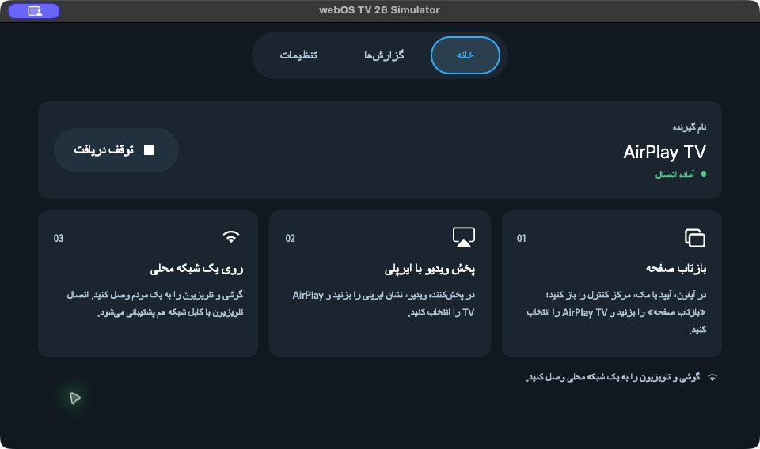
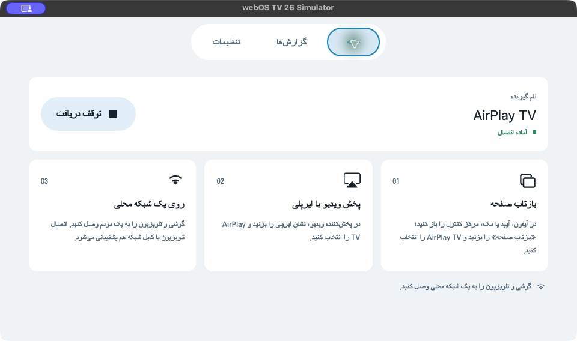

# webOS receiver verification — 2026-11-23

This is an experimental development build, not a certified TV release.

| Check | Observed result | Boundary |
| --- | --- | --- |
| JavaScript lifecycle, identity, transport and media startup tests | 29 passed | Unit/integration checks; not TV execution |
| Actual WASM receiver | Real TCP/UDP, discovery and RTSP `/info` binary plist (884 bytes) | macOS host smoke test; ephemeral listener |
| Actual WASM AAC LC decoder | 7168 stereo PCM samples; peak 3196/32768 | Generated codec fixture |
| Actual WASM ALAC decoder | 4096 stereo PCM samples; peak 2896/32768 | Generated codec fixture |
| LG Simulator service | Luna info succeeds; coreBuilt true; Node 18.18.2; receiver listener owned by Simulator process | Official webOS TV 26 Simulator 1.5.0 on macOS ARM64, not TV Node/OS |
| Teli dark/light UI | Both displayed in official Simulator | See the actual Simulator screenshots below |
| H264/PCM player, version 0.2.1 | 32-second jittered-input test: 960 video frames decoded/displayed; 1411200 stereo PCM samples scheduled; peak 0.08837890625; AudioContext running; zero schedule gaps, overlaps, underruns or clock resyncs | Separate synthetic test app using the production player; bypasses pairing, network and service decoder; not a listening test |
| Live iPhone Screen Mirroring, version 0.2.0 | Live portrait image displayed through the actual Simulator service; 538 decoded frames observed; 963840 stereo PCM samples scheduled with peak 0.897430419921875; user heard audio and reported crackling | Session stopped with video backlog/audio timestamp errors. Version 0.2.1 fixes reproduced timing failures, but post-fix iPhone listening is pending |
| TV IPK payload | App + service + WASM + worker + licenses; no test harness or native Node addon | Package inspection; not TV installation |
| Physical LG TV | Not tested | No LG device available |

The MediaSource startup race was reproduced and fixed: the first SPS/PPS packet now waits until `sourceopen`. A regression test verifies that readiness does not follow a queued start or a received packet, and that a real `playing` event precedes video mode. The synthetic test then displayed every frame of the generated eight-second H264 pattern. A separate regression test also reproduces late callbacks from a stopped player; session epochs now prevent those callbacks from feeding a new session.

The initial long `io.github...webos` service ID failed even with LG's template, while short `com.*` template IDs and the current `com.mehdiskan.airplaytv` app/service worked. The exact SDK naming/parser restriction is not established. Its caller metadata also reports the service itself as the sender, so real TV caller isolation must be checked separately. The app and its own service identities are allowed; unrelated identities are rejected by tests.

The reported crackling was investigated alongside actual `Video player fell behind` and `Audio timestamp discontinuity` logs. Three regression tests failed before the 0.2.1 fix: bursty delivery plus a stepped video clock produced PCM gaps/overlaps; late audio had no scheduling headroom; sparse screen updates compressed or rejected the video timeline. Audio now uses a contiguous sample-count clock with 120 ms headroom, bounded scheduling, underrun and clock-jump recovery. Video retains sparse-frame timing with cumulative millisecond rounding and catches up instead of stopping the session. All 29 tests passed, and the separate 32-second Simulator fixture test passed with no observed scheduling discontinuities. These findings do not establish that every source of the live crackling is resolved.

The host harness and temporary probe apps/services were stopped/removed from the Simulator after testing. The normal Teli app was restored with its own service ready. Do not equate packet counts, synthetic playback or scheduled PCM with verified end-to-end mirroring or audible TV output.
