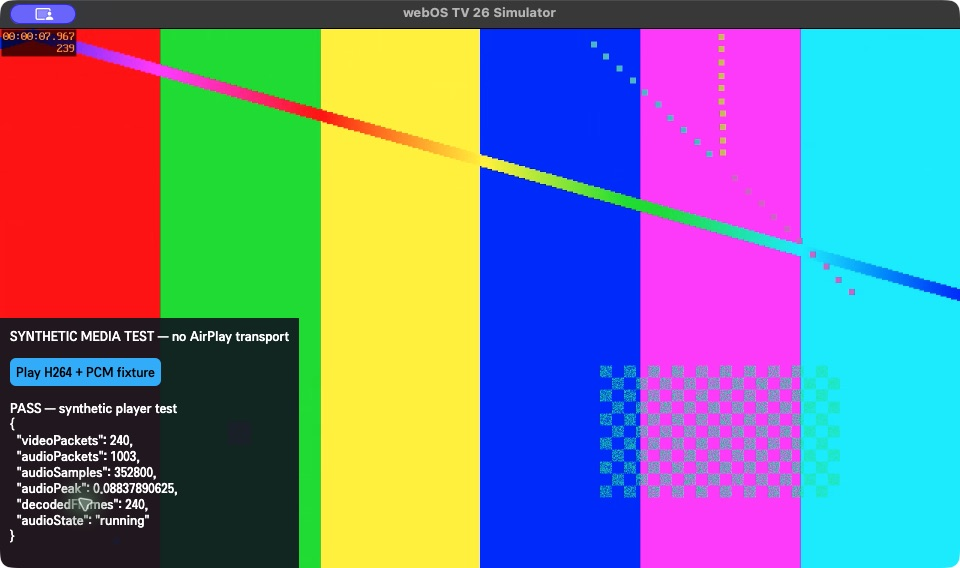

# webOS receiver verification — 2026-11-23

This is an experimental development build, not a certified TV release.

| Check | Observed result | Boundary |
| --- | --- | --- |
| JavaScript lifecycle, identity, transport and media startup tests | 25 passed | Unit/integration checks; not TV execution |
| Actual WASM receiver | Real TCP/UDP, discovery and RTSP `/info` binary plist (884 bytes) | macOS host smoke test; ephemeral listener |
| Actual WASM AAC LC decoder | 7168 stereo PCM samples; peak 3196/32768 | Generated codec fixture |
| Actual WASM ALAC decoder | 4096 stereo PCM samples; peak 2896/32768 | Generated codec fixture |
| LG Simulator service | Luna info succeeds; coreBuilt true; Node 18.18.2; receiver listener owned by Simulator process | Official webOS TV 26 Simulator 1.5.0 on macOS ARM64, not TV Node/OS |
| Teli dark/light UI | Both displayed in official Simulator | See the actual Simulator screenshots below |
| H264/PCM player | 240 video frames decoded and displayed; 352800 stereo PCM samples scheduled; PCM peak 0.08837890625; AudioContext running | Separate synthetic test app using the production player; bypasses pairing, network and service decoder |
| Live AirPlay input | Actual video and decoded audio packets reached the earlier host harness | Final live rendering/audio after the fix and inside the standalone Simulator service are not confirmed |
| TV IPK payload | App + service + WASM + worker + licenses; no test harness or native Node addon | Package inspection; not TV installation |
| Physical LG TV | Not tested | No LG device available |

The MediaSource startup race was reproduced and fixed: the first SPS/PPS packet now waits until `sourceopen`. A regression test verifies that readiness does not follow a queued start or a received packet, and that a real `playing` event precedes video mode. The synthetic test then displayed every frame of the generated eight-second H264 pattern.

The initial long `io.github...webos` service ID failed even with LG's template, while short `com.*` template IDs and the current `com.mehdiskan.airplaytv` app/service worked. The exact SDK naming/parser restriction is not established. Its caller metadata also reports the service itself as the sender, so real TV caller isolation must be checked separately. The app and its own service identities are allowed; unrelated identities are rejected by tests.

The host harness and temporary probe apps/services were stopped/removed from the Simulator after testing. The normal Teli app was restored with its own service ready. Do not equate packet counts, synthetic playback or scheduled PCM with verified end-to-end mirroring or audible TV output.
